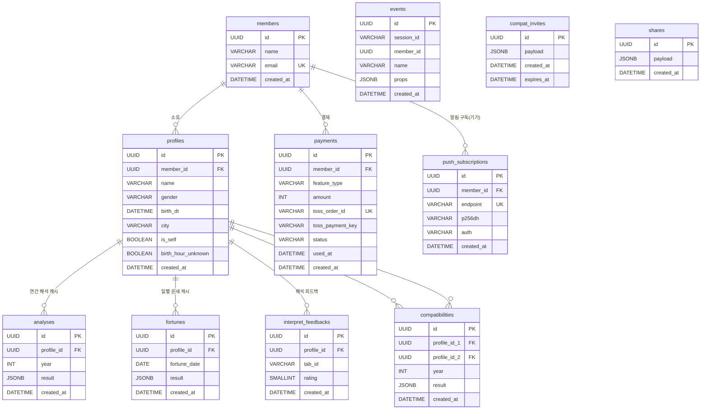

# BaZi (사주까치) 프로젝트 가이드

## 프로젝트 개요

사주팔자(四柱八字) 계산 및 오행 기반 종합 해석·시운·궁합·손금·풍수 웹 서비스.

- **백엔드**: Python 3.13 + FastAPI + sajupy + SQLAlchemy(asyncpg) + Alembic
- **프론트엔드**: Next.js 16 (App Router) + React 19 + TypeScript + Tailwind CSS 4
- **LLM**: Ollama 로컬 호출 (`OllamaAdapter`, 기본 모델 `qwen2.5:32b`) — 스트리밍 AI 풀이·챗·궁합 종합해석
- **MCP**: FastMCP 서버 `/mcp` 마운트 (도구 3종)
- **아키텍처**: Hexagonal Architecture (Port & Adapter), dependency-injector Singleton
- **패키지 관리**: uv (Python), npm (Node)

## 실행

```bash
# DB — /db 스킬 또는 scripts/db.sh (Colima 자동 기동 → 컨테이너 → healthy 대기 → alembic upgrade head → alembic check)
bash scripts/db.sh up
bash scripts/db.sh status | migrate "<메시지>" | reset --yes | down | logs [N] | sql "<query>"

# 백엔드 — 저장소 루트에서 실행 (src/kkachi/resource/local.toml 을 상대경로로 읽음)
uv run uvicorn kkachi.fastapi:app --reload --port 8000

# 프론트엔드 (2026-10-18부터 .next를 지우지 않는다 — 폰트는 로컬이라 구글 폰트 다운로드 없음)
cd frontend && npm run dev

# 테스트
uv run pytest            # 134 tests
cd frontend && npx tsc --noEmit

# 이 머신의 베타 인스턴스(launchd com.kkachi.* + Caddy :8080 + Tailscale Funnel)에 코드 반영
bash scripts/deploy.sh   # 프론트 production 빌드 → backend·frontend 재기동 → 헬스체크. 상세 docs/DEPLOY_PUSH.md, ~/kkachi/README.md
```

### 설정·환경변수

| 위치 | 키 | 용도 |
|------|----|------|
| `src/kkachi/resource/local.toml` | `[db] url` | DB 접속 (`Container.config.db.url`) |
| `src/kkachi/resource/local.toml` | `[toss] secret_key` | Toss 결제 confirm |
| `src/kkachi/resource/local.toml` | `[korea_weather_api]`, `[ipapi_api]`, `[api-key] openai` | **미사용** (코드에서 참조 없음) |
| env | `KKACHI_CORS_ORIGINS` (기본 `http://localhost:3000`), `KKACHI_CORS_ORIGIN_REGEX` | CORS |
| env | `OLLAMA_BASE_URL` (기본 `http://localhost:11434`), `OLLAMA_MODEL` (기본 `qwen2.5:32b`) | LLM |
| env | `KKACHI_VAPID_PUBLIC_KEY`·`KKACHI_VAPID_PRIVATE_KEY`·`KKACHI_VAPID_SUBJECT` | Web Push. 미설정이면 `/push/*` 503, 프론트 알림 버튼 숨김. **local.toml에 넣지 않는다** (`scripts/vapid_keygen.py`) |
| env | `KKACHI_ADMIN_TOKEN` | `/admin/push/send-daily?dry_run=false` 실발송 헤더 |
| `frontend/.env.local` | `NEXT_PUBLIC_API_URL` (기본 `http://localhost:8000`) | 프론트 → API |
| `frontend/.env.production` (gitignore) | `NEXT_PUBLIC_SITE_URL` | 링크 미리보기(OG)·sitemap의 절대 URL. **빌드 시** 주입되므로 `deploy.sh` 전에 있어야 한다. 베타는 ts.net 주소 |
| env | `KKACHI_API_INTERNAL_URL` (기본 `http://127.0.0.1:8000`) | 서버 컴포넌트·OG 이미지(`/s/[id]`)가 백엔드를 직접 부를 때. 브라우저는 `/api` rewrite |
| env | `KKACHI_DB_URL` | DB URL override — 앱(`fastapi.py`)·Alembic(`alembic/env.py`) 모두 env → local.toml → 기본값 순 |

- `src/kkachi/resource/hand_landmarker.task` (MediaPipe 손 랜드마크 모델, 7.8MB)는 **git 미추적** — 없으면 `/palmistry/analyze` 요청 시 실패. README의 curl 명령으로 다운로드.
- `frontend/next.config.ts`: `/api/*` → `127.0.0.1:8000` rewrite, `allowedDevOrigins`(tailscale 호스트·LAN IP·127.0.0.1). **dev 서버는 이 목록에 없는 호스트로 열면 HMR·dev 자원이 막혀 화면이 비어 보인다** — 폰 등 다른 기기에서 볼 IP는 여기 추가. 프로덕션(`next start`)은 무관.
- 이 머신은 `docker compose` 플러그인이 없고 `docker-compose` 바이너리만 있음 — `scripts/db.sh`가 둘을 자동 감지하므로 스크립트를 쓴다. launchd `com.kkachi.db`·`~/bin/kkachi-pg-backup.sh`도 같은 이유로 db.sh/자동 감지를 쓴다 (2026-09-18 수정).
- 베타 프론트는 `next start`(production 빌드)로 떠 있다. `npm run dev`는 더 이상 `.next`를 지우지 않고(2026-10-18) Next 16은 dev 산출물을 `.next/dev`에 따로 두므로 같은 디렉터리에서 개발해도 빌드 결과가 사라지지 않는다. 베타에 반영하려면 `bash scripts/deploy.sh`로 다시 빌드한다.

### DB 작업 규칙 (`/db` 스킬, `.claude/skills/db/SKILL.md`)
- 기동·마이그레이션·상태는 `bash scripts/db.sh <cmd>` 로만 한다. 손으로 `docker-compose up` + `alembic upgrade` 를 나눠 치지 않는다.
- 모델(`models.py`)을 바꾸면 `bash scripts/db.sh migrate "<메시지>"` → 생성된 리비전 파일 검토 → `up`. `up`·`status` 끝의 `alembic check` 가 모델↔DB 드리프트를 알려준다.
- `reset --yes` 는 로컬 데이터 전부 삭제 — 사용자가 명시적으로 요청했을 때만.
- 이미 적용된 리비전 파일은 수정하지 않는다 (downgrade 수정만 예외).

## 코드 구조

```
BaZi/
├── alembic/versions/            # 13개 마이그레이션 (아래 DB 스키마 참고). env.py 는 KKACHI_DB_URL → local.toml 순으로 URL 결정
├── docker/docker-compose.yml    # postgres:17 + pg_isready healthcheck, db/user/pw = bazi
├── scripts/db.sh                # DB up/status/migrate/reset/down/logs/sql — /db 스킬이 호출
├── scripts/send_daily_push.py   # 아침 알림 발송 (launchd 07:00) · vapid_keygen.py VAPID 키 생성 · deploy.sh 베타 반영(빌드+재기동) · art_convert.sh 캐릭터 그림 변환(원본 PNG → 1024 WebP + og/ 512 JPG — 사주 캐릭터용, 궁합 전용 그림은 2026-10-18 보류)
├── .claude/skills/db/SKILL.md   # /db 스킬: 서브커맨드 선택·실패 해석·reset 확인 규칙
├── docs/
│   ├── REFACTORING.md           # 리팩토링 규칙 + hot spot 표
│   ├── ROADMAP.md               # 제품 핵심 루프 로드맵 — 우선순위·진행 현황 (기능 추가 전 필독)
│   │                            # (화면 명세·시나리오·캐릭터 유형표 2종은 2026-10-17 specs/ 로 옮김 — 아래 specs/ 참고)
│   ├── llm_samples/             # LLM 리포트 프롬프트·해석 출력 샘플
│   └── research/                # 리서치 문서
├── specs/                       # 화면·기능 스펙 — 코드에 앞서는 약속 + 수용 기준 (2026-10-17 시작, 규칙·템플릿·화면 지도는 specs/README.md). 페이지 경로가 폴더, 단계·기능이 파일. 정식 스펙은 analysis/result.md · compatibility/result.md · analysis/character.md(사주 캐릭터 20유형 표·노출 규칙, 그림 프롬프트는 부록) · compatibility/character.md(궁합 캐릭터 15종·칭호·설명·문답 규칙 — compatibility_character.py와 함께 갱신), 나머지(home·join·my·profile·analysis/input·chat·compatibility/input·chat·siun·weather·palmistry·admin·shared)는 옛 화면 명세를 옮긴 초안
├── src/kkachi/
│   ├── fastapi.py               # 앱 + CORS + 라우터 8개 등록 + /mcp 마운트 + lifespan(local.toml 로드)
│   ├── container.py             # DI Container — Repo·Adapter·Service Singleton
│   ├── resource/                # local.toml, hand_landmarker.task
│   ├── domain/
│   │   ├── ganji.py             # Oheng, Stem, Branch, StemBranch, Pillar, Sipsin, SibiUnseong, Gongmang,
│   │   │                        #   StemCombine/StemClash, BranchCombine/Clash/Wonjin/Hyung/Hae/Pa, SAMHAP_GROUPS, OHENG_GUIDE
│   │   ├── natal.py             # Jeol, Samjae, Sinsal enum · Saju(hour=None이면 세 기둥) · NatalInfo · DaeunPeriod · PostnatalInfo
│   │   ├── interpretation.py    # InterpretBlock/Tip · FengShuiResult · ZodiacResult · Summary(탭별 요약 — 화면 노출 없음, LLM 기본 요약용으로 유지) · NatalResult · PostnatalResult · Interpretation
│   │   ├── fortune.py           # Fortune (일진 결과 + 아침 한 마디 headline/action/caution) · FortuneCache
│   │   ├── compatibility.py     # PillarRelation · PillarSnapshot · CompatibilityResult · Compatibility
│   │   ├── user.py              # User(hour_unknown 포함), Gender("male"|"female")
│   │   ├── member.py / profile.py / payment.py
│   ├── application/
│   │   ├── kkachi_service.py         # NatalService(analyze/interpret_natal) · PostnatalService(analyze/interpret_postnatal)
│   │   │                             #   · KkachiService(analyze/interpret/build_chat_context)
│   │   ├── profile_service.py        # 프로필 CRUD(최대 10개) + analyze_profile() 연도별 캐시
│   │   ├── fortune_service.py        # get_fortune()/get_forecast() — fortunes 캐시 + 날씨 주입
│   │   ├── push_service.py           # build_push_payload() + PushService(subscribe/unsubscribe/send_daily)
│   │   ├── fortune_rules.py          # compute_fortune() 일진 점수 룰 + _make_brief() 아침 한 마디, 24절기, 손없는 날
│   │   ├── timing_rules.py           # compute_timing() 영역×12개월 타이밍 (R3) · timing_digest()
│   │   ├── compatibility_service.py  # 궁합 점수 계산(기둥 합충·삼합·오행 보완·신살 → 총점, 영역별 _score_love/marriage/wealth/career)·캐시·관계유형 prose 재적용 (594 LOC) · build_compat_share_card(궁합 공유 카드 스냅샷 + character 칭호)
│   │   ├── compatibility_prose.py    # narrate_domain·advice_for·compute_key_traits·make_description — 궁합 점수·신호(pros/cons)를 문장으로. 관계 유형별 문장 표는 util/compatibility_meta
│   │   ├── compatibility_prompt.py   # format_chat_context·format_narrative_prompt — 궁합 결과 → LLM 챗 [데이터] 블록·종합해석 프롬프트
│   │   ├── saju_character.py     # build_saju_character(natal) 사주 캐릭터 20유형(일간×신강/신약) → NatalResult.character {key(그림 saju_character/{key}.webp), name, title, line, job, jobs[3](선호하는 일), jobs_avoid[3](선호하지 않는 일), strength_pct…} — 표는 specs/analysis/character.md §3과 함께 갱신(test_spec_table_matches_types가 대조)
│   │   ├── self_quiz.py              # build_self_quiz(natal 결과 dict) 설문조사 10문항 — 십신·지장간 조합 점수(천간 자리 가중 년8·월12·시10 + 지지 자리 가중 년8·월30·일15·시12 × 지장간 비중 + 투출 5, 신강·신약과 같은 가중)가 8점 이상이면 그렇다(2026-10-13, 300명 표본 평균 5.2개). 근거 문장은 개수 대신 자리·투출로 ("태어난 달 천간에 드러나고 지지에도 뿌리를 둔 …"). 지장간 없는 옛 결과는 지지 본기로 (V3, 설문으로 출생시간 추정 안 함)
│   │   ├── compatibility_daily.py    # compute_daily_compat() 오늘의 궁합 (홈 배지·R5) + 2026-10-18 각자의 오늘(compute_fortune 재사용)·영역별 함께 문구(_TOGETHER)·팁
│   │   ├── compatibility_character.py # build_compat_character(result dict, relation_type) 궁합 캐릭터 — 일간 오행 쌍 비유 칭호(장작과 모닥불 등 15종)·일주 합충 수식어·관계 유형별 커플/콤비/가족·설명 + 설문조사("이럴 때 두 분은?") 문답 — 십신마다 1문항(6~10개, 모자라면 강약·신살 질문으로 채움). 예측은 스냅샷 `sipsin_score`(설문조사와 같은 십신·지장간 점수)로 더 뚜렷한 쪽, 차이 5점 미만은 둘 다, 둘 다 8점 미만인 십신은 묻지 않음(2026-10-15). 점수 없는 옛 캐시는 `sipsin` 개수로, 그것도 없으면 고정 6문항. 근거 문장엔 개수·점수 미노출 · `moments{good[3],hard[3]}` 잘 맞는 순간·부딪히기 쉬운 순간 칩(그림 키 15종 공통, 관계 유형 무관, 2026-10-17 — specs/compatibility/character.md §5-1과 테스트로 대조)
│   │   ├── compatibility_zodiac.py   # build_compat_zodiac(result dict, year) 띠궁합 — 두 사람 년지 띠 정보·띠끼리 충합·4년 연도별 각자 관계 (스냅샷 년주만 써서 옛 캐시에도 동작)
│   │   ├── compatibility_summary.py  # build_compat_summary(result dict) 궁합 한눈에 {pillars, element, strength, sinsal, domain} — 이름은 {p1}·{p2} 토큰, 캐시 hit에도 매번 계산
│   │   ├── member_service.py         # 이메일 중복 시 기존 반환
│   │   ├── payment_service.py        # Toss prepare/confirm (deep_analysis 1900 · daily_fortune 990 · compatibility 1500)
│   │   ├── report_builder.py         # LlmReportBuilder — Interpretation → LLM 프롬프트용 마크다운
│   │   ├── port/                     # saju(Natal/Postnatal/Interpreter), member, profile, analysis, compatibility,
│   │   │                             #   fortune, weather, payment, feedback, llm, event, push(PushPort·PushSenderPort)
│   │   ├── interpreter/              # 13개: advice · daeun · fengshui · fortune · hand_shape · narrative · natal(함수 모음 + build_summary)
│   │   │                             #   · personality(Personality+ElementBalance) · relationship · samjae · seun · yongshin · zodiac
│   │   ├── use_case/                 # get_saju_context · get_annual_fortune · get_weather (MCP 도구용)
│   │   └── util/                     # util.py(year_to_ganji, branch_relation, josa…) · sipsin_meta · clash_combine_meta · zodiac_meta · compatibility_meta(RelationType, 관계 유형별 라벨·영역 문장 표, level_for/label_for)
│   └── adapter/
│       ├── inner/
│       │   ├── kkachi_controller.py        # prefix /kkachi — interpret · chat · stream-report · shares POST/GET(결과 공유 카드)
│       │   ├── member_controller.py        # /members
│       │   ├── profile_controller.py       # /members/{id}/profiles — CRUD·PATCH·analyze·analyses·daily·forecast·feedback(POST/GET)
│       │   ├── compatibility_controller.py # /compatibility — ""·direct·chat·narrative
│       │   ├── payment_controller.py       # /payments — prepare·confirm
│       │   ├── palmistry_controller.py     # POST /palmistry/analyze (MediaPipe 랜드마크 + OpenCV 손금선 밀도)
│       │   ├── weather_controller.py       # GET /weather
│       │   ├── admin_controller.py         # GET /admin/feedback/summary · /admin/events/summary
│       │   ├── event_controller.py         # POST /events (행동 이벤트, ROADMAP F0)
│       │   ├── push_controller.py          # /push — vapid-public-key · subscriptions POST/DELETE
│       │   └── mcp_server.py               # FastMCP "사주까치" — get_saju_context · get_annual_fortune · get_weather_element
│       └── outer/
│           ├── natal_adapter.py            # NatalAdapter + cal_saju() (도시→경도 내부 룩업, sajupy 호출)
│           ├── postnatal_adapter.py        # PostnatalAdapter — 세운·대운·월운·충합·영역점수(reason 포함)·삼재
│           ├── weather_adapter.py          # Open-Meteo geocoding + forecast (past_days=14), WMO → 오행
│           ├── llm/ollama_adapter.py       # OllamaAdapter — get_advice · interpret · stream_chat · stream_interpret
│           ├── push/webpush_adapter.py     # WebPushAdapter (pywebpush, VAPID env) — 404/410이면 구독 소멸 반환
│           └── db/
│               ├── models.py       # MemberModel · ProfileModel · AnalysisModel · FortuneModel · CompatibilityModel
│               │                   #   · InterpretFeedbackModel · PaymentModel · EventModel · PushSubscriptionModel · CompatInviteModel · ShareModel
│               ├── member_repo.py  # MemberRepo
│               ├── invite_repo.py  # InviteRepo(compat_invites, 30일) · ShareRepo(shares, 만료 없음)
│               ├── profile_repo.py # ProfileRepo · AnalysisRepo · FortuneRepo · CompatibilityRepo · FeedbackRepo
│               └── payment_repo.py # PaymentRepo
├── frontend/src/
│   ├── app/
│   │   ├── page.tsx                 # 홈 — 비로그인: QuickStartPost(30초 퀵스타트 폼) / 로그인: StoryTray · 프로필별 FortunePost(7일 예보) · VideoPost
│   │   ├── s/[id]/                  # 공유 카드 랜딩 (서버 렌더, 로그인 없음) — page.tsx(사주/시운/궁합 kind 분기) · opengraph-image.tsx · share.ts(백엔드 직접 fetch)
│   │   ├── opengraph-image.tsx      # 사이트 기본 OG 이미지 (satori) · robots.ts(/s/ 색인 금지) · sitemap.ts
│   │   ├── layout.tsx · fonts/      # 루트 레이아웃 — 화면 폰트는 next/font/local 서브셋 WOFF2(fonts/: Noto Sans KR·Noto Serif KR 가변, 상용 한글 2,350 + 코드의 한자 247; 빌드·dev가 구글 폰트를 받지 않음 2026-10-18, 재생성은 fonts/README.md)
│   │   ├── analysis/page.tsx        # 사주 분석 — 프로필 선택 / 직접 입력 → ResultSlides (로그인 불필요)
│   │   ├── analysis/deep/page.tsx   # /analysis 로 redirect 만 함 (구 심층 분석 경로 호환)
│   │   ├── chat/page.tsx            # 까치 상담 풀스크린 챗 (sessionStorage 입력값 → /kkachi/chat)
│   │   ├── compatibility/page.tsx   # 궁합 — PersonCard×2 · 관계 유형 · 스트리밍 종합해석 · ?p1=&p2= 딥링크 · 결과 뷰에 relationType·memberId·profileId×2(제출 시점 스냅샷, 오늘의 궁합) 전달
│   │   ├── compatibility/chat/page.tsx
│   │   ├── siun/page.tsx            # 시운(時運) — 아침 한 마디, 알림 켜기(PushSubscribeButton), 프로필 전환, 지난주(맞았어요? 👍/👎)·오늘~글피, 14일 전~31일 예보
│   │   ├── manifest.ts              # PWA 매니페스트 (/manifest.webmanifest)
│   │   ├── weather/page.tsx         # 날씨 오행 (GPS → ipapi → Seoul), 로그인 시 용신 팁
│   │   ├── palmistry/page.tsx       # 손금 (idle → preview → loading → result)
│   │   ├── join/ · my/ · profile/   # 가입/로그인 · 계정(로그아웃·탈퇴) · 프로필 관리
│   │   └── admin/feedback/page.tsx  # 탭별 👍/👎 요약 대시보드
│   ├── components/
│   │   ├── ResultSlides.tsx         # 결과 오케스트레이터 — 9개 feature 탭(?tab=, 기본 natal. 한눈에 탭은 2026-10-13 제거 — 옛 ?tab=summary는 natal로) + 탭 끝 NextTabCard("다음 이야기" — 흥미 유발 제목 hook만, 내용 미리보기 없음) + FeedbackBar + SajuChat FAB. 탭 전환은 history.replaceState(서버 왕복 없음) + 새 탭 첫 줄로 스크롤
│   │   ├── ResultIntro.tsx          # 분석 직후 전체 화면 인트로(?step=intro, 건너뛰기 가능) — 캐릭터 공개(SajuCharacterCard RevealGate 천간 슬롯) → 캐릭터 인사 말풍선 → [📋 설문조사 → ?step=survey] / [🗺️ 내 사주 분석 보기 → "운세 지도 펼치는 중…" → ?tab=natal]. 결과 단계는 한 페이지 안 주소(?step=)로 관리(pushState — 뒤로 가기로 설문 → 인트로). 새 결과(주소에 step·tab 없음)만 인트로, natal.character 없으면 생략. 설문 화면은 ResultSlides가 같은 전체 화면 틀로 SelfQuizCard를 띄움 — 제출해도 일치율은 여기서 안 보여주고 "답변 완료! 설문조사 탭에 숨겨 뒀어요" 화면만(일치율은 설문조사 탭에서 공개, 다음 이야기 카드도 "몇 % 맞았을까?"로 예고)
│   │   ├── NextTabCard.tsx          # 탭 끝 "다음 이야기" 카드 공용(분석 ResultSlides · 궁합 CompatibilityResult) — 흥미 유발 제목(hook)만, 마지막 탭은 첫 탭으로
│   │   ├── SelfQuizCard.tsx         # 설문조사(V3, 2026-10-13 "내 사주 맞춰 보기"에서 이름 변경) — 설문조사 탭(AI 풀이 앞) 선택형. 10문항 그렇다/아니다를 **5문항씩 2페이지**로 답하고(2026-10-17 — 페이지는 카드 안 상태, 처음엔 안 답한 첫 페이지부터, 이 페이지를 다 답해야 다음·이전은 링크, 넘기면 카드 첫 줄로 스크롤) 한꺼번에 사주 예측과 비교 → "사주와 설문 응답의 일치율" % + 아래 KkachiTip으로 구간별 해설 한 문장(같은 답 수/10 — 신뢰도·사주 스타일 라벨은 2026-10-13 제거) + 문항별 일치(다른 문항 먼저·근거는 다른 문항에만, 일치 문항은 짧게)(상태는 ResultSlides, 서버 저장 없음). 인트로의 ?step=survey 화면에서도 같은 상태로 뜸
│   │   ├── ShareButton.tsx          # 공유 버튼 공용(create·title·text·label) — 분석 결과(createShare)·시운(createDailyShare)·궁합(createCompatShare) → /s/{id} 링크 · OG 미리보기/저장/이미지 공유(파일명 사주까치_{제목}_{YYYYMMDD}.png)
│   │   ├── OgCard.tsx               # OG 이미지 JSX(satori) + 폰트·마스코트 로더 + 캐릭터 그림 로더 loadCharacterArt(saju_character/og/{key}.jpg — 사주 카드 1장·궁합 카드는 두 사람 것 2장) (경로별 캐시, 서버 전용, fs)
│   │   ├── AnalysisForm.tsx         # 이름·생년월일·시간(12지시)·성별 · 정밀 설정(분석연도) · 경도 자동(비노출) · quick 모드(홈, 저장 단계 없음)
│   │   ├── CompatibilityResult.tsx  # 궁합 결과 오케스트레이터 — 7탭 정의(hook 포함)·?tab=·?step=(intro·scenario, 다른 파라미터 보존, pushState)·탭바·탭 끝 NextTabCard·탭 전환 시 첫 줄로 스크롤·캐시 기본값 한 번 채우기. 인트로·문답이 덮는 동안엔 탭 본문을 마운트하지 않음. 본문은 compatibility/
│   │   ├── compatibility/           # CompatIntro(결과 직후 전체 화면: 두근두근 RevealGate → CompatCharacterBox 칭호·점수 → 까치 인사 → [📋 설문조사]/[궁합 분석 보기]) · CompatTotal(RevealGate 두 캐릭터 실루엣·PairArt·CompatCharacterBox·CompatCharacterCard 두 분의 캐릭터 카드(팔자비교 탭, 2026-10-17)) · ScenarioCard(이럴 때 두 분은?, 5문항씩 페이지) · StrengthCard(신강·신약) · ZodiacTab(띠궁합) · PillarsTab · ElementTab · SinsalTab · DomainTab · DailyTab(GET /compatibility/daily, 프로필×2일 때만) · NarrativeTab · types.ts(CompatTabProps)
│   │   ├── PersonCard.tsx · ProfileCard.tsx · ProfileForm.tsx
│   │   ├── MorningBrief.tsx         # 아침 한 마디(헤드라인·할 것·피할 것) — 홈·시운(오늘~글피·지난주) 공용
│   │   ├── PushSubscribeButton.tsx  # 아침 알림 켜기/끄기 (미지원·VAPID 미설정이면 숨김)
│   │   ├── SajuChat.tsx · CompatibilityChat.tsx   # /chat, /compatibility/chat 로 가는 FAB
│   │   ├── PillarDetail · PillarOhengGrid · ElementRadar · OhengAnalysis · OhaengRelationDiagram
│   │   ├── OhengPairDiagram · PillarPairDiagram   # 궁합 비교 다이어그램
│   │   ├── DaeunTimeline · DaeunSeunTable · DomainBarChart · ScoreBar
│   │   ├── LoginRequired.tsx        # 로그인 필수 페이지의 비로그인 안내 카드 (시운·궁합) → /join (복귀 경로는 lib/loginNext)
│   │   ├── PageHeader.tsx           # 페이지 제목 줄 공통(제목 2xl·설명 sm·우측 액션). 페이지 틀은 globals.css .page/.page__inner (홈·챗 제외)
│   │   ├── SectionHeader · CollapsibleSectionHeader · InlineCollapsibleHeader · InterpretSection
│   │   ├── KkachiTip · TermBadge · Tooltip · FeedPost · BottomNav · LoadingSpinner
│   │   └── tabs/
│   │       ├── NatalTab.tsx         # 만세력 — natal/ 4개 섹션(팔자·십신·지장간·공망) 조합 · EnergyTab = 신살·운성(SibiUnseong·Sinsal)
│   │       ├── natal/               # PillarSection · StrengthSection(신강·신약) · SipsinSection · JizanganSection · GongmangSection
│   │       │                        #   · SibiUnseongSection · SinsalSection · data.ts(SIPSIN_INFO, SINSAL_INFO 등 표시 메타)
│   │       ├── YongshinTab · SamjaeTab            # "용신·삼재" 탭
│   │       ├── DaeunTab · SeunTab · WolUnTab · FortuneTab   # "시운(時運)" 탭
│   │       ├── TimingTab            # "언제가 좋을까" 탭 — postnatal.timing 12칸 (R3)
│   │       └── ZodiacTab · FengShuiTab · AiTab
│   ├── lib/
│   │   ├── api.ts                # 모든 API 호출 + 스트리밍 reader
│   │   ├── ganji.ts              # 천간·지지 표시 메타 SoT (해석 분기 금지)
│   │   ├── track.ts              # 행동 이벤트 track(name, props) — 세션 UUID + fire-and-forget
│   │   ├── useStorageValue.ts    # localStorage/sessionStorage를 hydration-safe하게 읽는 훅(useSyncExternalStore) + parseStored — 마운트 effect 안 setState 금지
│   │   ├── push.ts               # getPushState/subscribePush/unsubscribePush — sw.js 등록 + VAPID 구독 + 서버 저장
│   │   ├── elementColors.ts · zodiac.ts · glossary.ts · relations.ts · constants.ts · location.ts
│   └── types/analysis.ts
├── frontend/public/kkachi/       # normal/good/caution 까치, icon-192/512(PWA), saju_character/(20유형 {일간}_{강|약}.webp 화면용 + Gemini 원본 .png + og/{key}.jpg 512px OG용 — satori가 WebP를 못 읽어 따로 둠), (궁합은 전용 그림 없이 두 사람의 saju_character 그림을 나란히 — 2026-10-18, 15장 제작 보류), sinsal/ sipsin/ sipgan/ zodiac/ strength/ samjae/ sibi_unseong/
├── frontend/public/sw.js         # 서비스워커 — push 수신·클릭(/siun?src=push)만, 오프라인 캐시 없음
├── frontend/public/fonts/        # OG 이미지용 Noto Sans KR 400·700 서브셋 WOFF (한글 전체 + 코드에 쓰인 한자 242자, README 참고) — 화면용은 src/app/fonts/
├── frontend/public/oheng/        # 오행 이미지 5종
└── tests/
    ├── adapter/       # test_analyzer · test_fortune · test_sibi_unseong
    └── application/   # test_interpret · test_compatibility
```

## 아키텍처 원칙

- **Hexagonal Architecture**: 도메인 로직은 외부 의존성과 분리. `domain/`에서 sajupy·sqlalchemy import 금지
- **Port & Adapter**: 추상 인터페이스(Port ABC) → 구현체(Adapter). Application이 Adapter를 직접 import 금지 (Container 경유)
- **DI**: dependency-injector Singleton, 컨트롤러에서 `@inject` + `Depends(Provide[Container.xxx])`
- **dataclass 직렬화**: schema 레이어 없이 `asdict()`로 직접 JSON 변환 (컨트롤러 요청 모델만 Pydantic)
- **컨트롤러는 thin**: 검증·HTTP 변환만. 예외: 챗/스트리밍 컨트롤러가 `svc._llm_port`에 직접 접근 중

## 데이터 흐름

```
POST /kkachi/interpret  (로그인 불필요)
  → KkachiService.analyze(user, year)
      → NatalAdapter.analyze     → NatalInfo   (간지, 오행, 강약, 용신, 십신, 십이운성, 신살, 지장간, 십이신살, 공망)
          강약 strength_pct 0~100(50↑ 신강, 중화 없음): 일간 뺀 자리별 가중(월지30·일지15·시지12·월간12·시간10·년간8·년지8) × 돕는 비율(지지는 지장간 비중, 월지는 왕상휴수사와 반반), 원점수 42 → 50% 구간 선형 변환. 용신은 50 기준
      → PostnatalAdapter.analyze → PostnatalInfo (세운, 대운, 월운 6개월, 충합, 영역점수+reason, 삼재)
  → KkachiService.interpret(natal, postnatal, user, name)
      → NatalService.interpret_natal       → NatalResult  (narratives, personality, element_balance, feng_shui, zodiac …)
      → PostnatalService.interpret_postnatal → PostnatalResult (yongshin, fortune_by_domain, annual/major/samjae_fortune, advice …)
      → compute_fortune(오늘) → build_summary → PostnatalResult.summary (첫 화면 다섯 줄)
      → Interpretation(natal, postnatal)
  → asdict() → JSON

POST /members/{id}/profiles/{pid}/analyze
  → ProfileService.analyze_profile → analyses(profile_id, year) 캐시 우선 → 없으면 위 파이프라인 후 저장
     캐시 히트여도 summary.today_date가 오늘이 아니면 오늘 줄만 재계산해 upsert (summary 없는 옛 캐시는 전체 재계산)

POST /kkachi/stream-report  (AI 풀이 탭)
  → analyze + interpret → LlmReportBuilder.build() 마크다운 → OllamaAdapter.stream_interpret → text/plain 스트림

POST /kkachi/chat  (까치 상담)
  → analyze + interpret → KkachiService.build_chat_context() → system prompt → OllamaAdapter.stream_chat

GET /members/{id}/profiles/{pid}/forecast?days=N&start_date=
  → FortuneService.get_forecast → 날짜별 fortunes 캐시 확인 → compute_fortune(natal, date, weather, postnatal) → upsert
```

- 시운(時運)·대운·세운·월운, 풍수(팔택풍수), 십이지신, 신살 해석 텍스트는 **모두 백엔드**에서 생성.
- 프론트 `lib/ganji.ts`·`tabs/natal/data.ts`는 표시용 메타(이름/색상/한 줄 태그라인)만 — 해석 분기 금지.

## Always / Never

**ALWAYS:**
- `uv run`으로 Python 실행 (pip, python 직접 실행 금지)
- 테스트를 먼저 실행해서 기존 동작 확인 후 수정
- 3개 이상 파일 변경 시 Plan 먼저
- **리팩토링 작업 시 `docs/REFACTORING.md`를 먼저 읽을 것**
- DB 기동·마이그레이션은 `/db` 스킬(`scripts/db.sh`)로 — 모델 변경 후 `alembic check` 드리프트 0 확인
- API·페이지·DB 스키마를 바꾸면 이 문서의 해당 섹션도 같은 커밋에서 갱신
- **화면·기능을 바꾸기 전에 `specs/<경로>/<단계>.md`가 있으면 먼저 읽고**, 바꾼 뒤 같은 커밋에서 그 스펙의 수용 기준·변경 이력을 갱신 (스펙과 코드가 어긋나면 스펙부터)

**NEVER:**
- `git push --force`
- `rm -rf`
- `.env` 파일·`local.toml`의 실제 키 값 수정 또는 외부 전송

## Anti-bloat rules

**IMPORTANT: YOU MUST follow these rules:**
- 단일 사용 helper/util 함수 생성 금지 — 3번 이상 쓰일 때만 추출
- 래퍼, 팩토리, 불필요한 인디렉션 추가 금지
- 현재 태스크에 필요한 최소 복잡도만 사용
- 비슷한 코드 3줄 > 성급한 추상화
- 새 파일 생성보다 기존 파일 수정 우선

## 제품 방향 — "와, 진짜 내 얘기네?" 만들기

세 축 모두 **인프라는 깔림**. 다음 단계는 품질 튜닝.
**우선순위·진행 현황은 `docs/ROADMAP.md`가 정식 출처** (2026-09-12 핵심 루프 재정의: F0 측정 → R1 요약 카드 → R2 시간 모름 → R3 타이밍 리포트 → R4 알림 → R5 궁합 공유 → R6 연속성). 제품 기능을 추가하기 전에 ROADMAP §4·§5를 먼저 본다.

### ① 하이브리드 해석 엔진 (Rule + LLM) — 구현됨
- Rule 엔진(Interpreter 13개) → 구조화 데이터 → `LlmReportBuilder` 마크다운 → Ollama가 자연어로 변환
- 진입점: AI 풀이 탭(`/kkachi/stream-report`), 까치 상담(`/kkachi/chat`), 궁합 종합해석(`/compatibility/narrative`)·궁합 챗
- LLM은 해석 생성기가 아닌 **언어 변환기**. 한국어 강제·225자 제한·"사주에 따르면" 금지 규칙이 시스템 프롬프트에 있음
- 다음: 프롬프트 품질, 응답 지연(`num_predict` 500/700, `keep_alive` 10m) 튜닝

### ② 점수 근거 시각화 (Domain Scores) — 백엔드 구현됨
- `PostnatalAdapter._get_domain_scores` → `{score, level, reason}` (reason = 세운·대운 십신 근거 문장)
- 일진도 `compute_fortune` → `domain_scores[*].reason`
- 다음: 프론트 툴팁/아코디언 노출 보강

### ③ 피드백 루프 (Feedback Loop) — 구현됨
- `ResultSlides` 하단 FeedbackBar 👍/👎 → `POST .../feedback {tab_id, rating}` → `interpret_feedbacks`
- 시운 "지난주" 탭의 일진 회고("맞았어요?")도 같은 테이블에 `tab_id="daily:YYYY-MM-DD"`로 저장. 대시보드에서는 `daily` 한 줄로 집계 (R6)
- `/admin/feedback` 대시보드가 긍정률 낮은 탭 순으로 정렬
- 다음: 낮은 탭의 Interpreter부터 개선

## 코딩 컨벤션

- 인라인 import 금지 — 모든 import는 파일 최상단에 위치
- `__init__.py`는 비워두거나 re-export만
- 모듈 최상단 docstring 없음 (클래스 docstring만)
- 섹션 구분 주석 (`# ──`) 사용 금지
- 메서드명은 `_get_*` 패턴
- private `_` prefix는 모듈 내부용에만
- async 우선 (FastAPI 파이프라인 전체)
- 상수는 사용처 가까이 위치 (constant.py 분리 안 함)
- **클래스 메서드 순서**: public 메서드 상단, private(`_`) 메서드 하단
- UI 텍스트 레이블은 **한글(한자)** 병기 — 예) 용신(用神), 신강(身強)
- ruff: line-length 100, select E/F/I/UP (E501 무시). `.claude/hooks/lint.sh`가 Write/Edit 시 자동 실행

## API 스펙

`gender`는 항상 `"male" | "female"`. 응답은 dataclass `asdict()` 그대로.

```
# 사주 해석 (kkachi_controller, prefix /kkachi)
POST /kkachi/interpret       { birth_dt, gender, analysis_year=2026, city="Seoul", longitude?, name="", hour_unknown=false }
                             → { natal: NatalResult, postnatal: PostnatalResult, self_quiz: [{q, basis, count, score, predict: yes|no, reason}] }  (self_quiz = 설문조사 10문항, 프로필 /analyze 응답에도 붙음)
POST /kkachi/stream-report   같은 요청 → text/plain 스트림 (LLM AI 풀이)
POST /kkachi/chat            { birth_dt, gender, analysis_year, city, name, messages:[{role,content}] } → text/plain 스트림
POST /kkachi/shares          interpret와 같은 요청 → 201 { share_id }  (서버가 계산한 카드 스냅샷만 저장, 생년월일·성별 미저장)
GET  /kkachi/shares/{id}     → ShareCard (kind 없음=사주) 또는 DailyShareCard (kind="daily") 또는 CompatShareCard (kind="compat") { name, year, pillars, pillar_elements, hour_unknown, day_stem, element_stats, strength_label, yongshin, pillar_summary, sinsal[], character{key,stem,stem_korean,element,strong,strength_label,title,line,jobs,jobs_avoid}|null(나의 캐릭터 V4, 2026-10-16 이후 카드), summary{me,energy,yongshin,year,caution} }  404 if 없음

# 회원
POST   /members              { name, email } → 201 Member (이메일 중복 시 기존 반환)
GET    /members/{id}
DELETE /members/{id}         → 204 (프로필·분석·궁합·일진·피드백 cascade)

# 프로필 (prefix /members/{member_id}/profiles) — /{pid} 경로는 모두 소유자 검증: profile.member_id ≠ URL member_id 이면 404 (IDOR 방지)
POST   ""                    { name, gender, birth_dt, city="Seoul", is_self=false, birth_hour_unknown=false } → 201 (10개 초과 시 400)
GET    ""                    → Profile[]
GET    /{pid}
PATCH  /{pid}                { name, gender, birth_dt, city, birth_hour_unknown } — 출생정보 변경 시 analyses·fortunes 캐시 삭제
DELETE /{pid}                → 204 (is_self 프로필은 409)
POST   /{pid}/analyze        { year=2026 } → Interpretation dict (analyses 캐시 우선)
POST   /{pid}/set-self       → Profile  기본 프로필(나) 지정 — 같은 회원의 다른 프로필은 is_self=false (캐시 유지)
GET    /{pid}/analyses       → [{ year, created_at }]  캐시된 연도 목록 — "지난 연도 다시 보기" (R6)
GET    /{pid}/daily          → Fortune dict (오늘, fortunes 캐시 + 날씨 없으면 재계산)
POST   /{pid}/daily/share    → 201 { share_id }  오늘 시운 공유 카드(kind="daily": 일진·점수·아침 한 마디·날씨, 생년월일 없음) → /s/{share_id}
GET    /{pid}/forecast       ?days=7&start_date=YYYY-MM-DD → Fortune[] (days 최대 35, 과거 날짜 가능)
POST   /{pid}/feedback       { tab_id, rating } → { success }   (일진 회고는 tab_id="daily:YYYY-MM-DD")
GET    /{pid}/feedback       ?prefix=daily: → { tab_id: rating }  (같은 tab_id는 마지막 값)

# 궁합 (prefix /compatibility) — relation_type: "lover" | "friend" | "family" (기본 lover)
POST /compatibility          { profile_id_1, profile_id_2, year, relation_type } → CompatibilityResult (캐시 우선, 404 if 없음)
POST /compatibility/direct   { person1:{name,gender,birth_dt,city,hour_unknown?}, person2, year, relation_type } → stateless
#   궁합 결과(POST /compatibility·/direct·invite resolve)에는 summary { pillars, element, strength, strength_p1, strength_p2, sinsal, zodiac, domain }(화면 노출 없음 — 2026-10-15 한눈에 탭 제거, LLM 기본 요약용으로 유지), character { title, kind, key(유형 키 예 木火 — 그림 키 아님), roles[2]{token, name, element, emoji, character_key(그 사람 사주 캐릭터 키 예 무_강 → 그림 saju_character/{character_key}.webp, 2026-10-18)}, desc, moments{good[3], hard[3]}, scenarios[6~10]{q, who:p1|p2|both, reason, basis} }, zodiac { p1, p2, relation, relation_label, headline, chunghap{relation, title, explain, trio, ring[12], friends}, pillars{columns[4], cross[], tip}, years[{year, ganji, kor, emoji, rel1, rel2}], years_line } (한눈에, {p1}·{p2} 이름 토큰)가 붙는다 — 캐시에는 저장하지 않고 응답 때 계산
POST /compatibility/narrative 같은 요청 → text/plain 스트림 (LLM 종합해석)
POST /compatibility/chat     { person1, person2, year, messages, relation_type } → text/plain 스트림
POST /compatibility/shares   DirectCompatibilityRequest → 201 { share_id }  궁합 공유 카드(kind="compat": 점수·라벨·영역 점수·두 사람 일간 p1/p2{stem,korean,element(일간 글자 오행),hour_unknown}·특징·character{title,key,roles[{name,element,emoji,character_key}],desc(이름 채움),moments{good,hard}}) → /s/{share_id}
POST /compatibility/invites  { person1, relation_type } → { invite_id }  (초대자 정보 저장, 30일 TTL) — 생성 UI는 2026-09-28 제거, ?invite= 링크 처리만 유지
GET  /compatibility/invites/{id}          → { name, relation_type }  (민감정보 제외)
POST /compatibility/invites/{id}/resolve  { person2, year } → CompatibilityResult
GET  /compatibility/daily    ?member_id&p1&p2 → { date, day_pillar, score, level, headline, day_element, solar_term, son_eomneun_nal, persons[2]{name, relation(육합·삼합·같음·보통·충), relation_label, yongshin, yongshin_hit, score, level, headline, action, caution}, domains[4]{key(재물·연애·직업·건강), score1, score2, level(낮은 쪽 기준), label}, tips[≤3] }  (오늘의 궁합, 소유자 검증 — 2026-10-18 각자의 오늘은 compute_fortune 재사용, 날씨·대운 없이; 앞 5개 필드는 홈 배지가 씀)
GET  /compatibility/forecast ?member_id&p1&p2&days=14 → { days: [ /daily 모양 × N ] }  (오늘부터 N일, 최대 31, 연도 바뀌면 그 해 natal로. 궁합 결과 시운 탭용, 2026-10-18)

# 기타
GET  /weather                ?city=Seoul&days=7&lat&lon → DailyWeather[] (days 최대 14, 응답에 과거 14일 포함)
POST /palmistry/analyze      multipart image → { hand_element, hand_type_korean, finger_ratio, aspect_ratio, line_scores{heart,head,life}, blocks[] }
POST /payments/prepare       { member_id, feature_type: deep_analysis|daily_fortune|compatibility } → { order_id, amount, feature_type, order_name }
POST /payments/confirm       { payment_key, order_id, amount } → Toss confirm → { success }   (프론트 결제 게이트는 제거됨)
GET  /admin/feedback/summary → [{ tab_id, total, positive, negative, positive_rate }] 긍정률 오름차순. tab_id는 ':' 앞까지로 묶음(daily:* → daily)
POST /events                 { session_id, name(snake_case), member_id?, props? } → 202   (프론트 lib/track.ts)

# 아침 알림 (prefix /push) — VAPID env 미설정 시 503
GET    /push/vapid-public-key   → { public_key }
POST   /push/subscriptions      { member_id, subscription:{ endpoint(https), keys:{p256dh, auth} } } → 201 (endpoint upsert)
DELETE /push/subscriptions      { endpoint } → 204
POST   /admin/push/send-daily   ?dry_run=true(기본)&member_id= → [{member_id, profile, title, body, status}]  실발송은 X-Admin-Token 필요
GET  /admin/events/summary   ?days=7 → [{ name, count, sessions }]
# /admin/* 전체: 서버에 KKACHI_ADMIN_TOKEN이 설정돼 있으면 X-Admin-Token 헤더 일치 필수(401). 미설정(로컬 개발)이면 열림

# MCP (/mcp, streamable HTTP)
get_saju_context(birth_dt, gender, year, city, name) → str (~600자 요약)
get_annual_fortune(...)                                → dict (영역점수·세운·삼재·대운·충합)
get_weather_element(city)                              → dict (condition, element, temperature)
```

## DB 스키마



> `shares`(5bd6657a0541)는 결과 공유 카드 스냅샷 — FK·만료 없음, `payload`는 `KkachiService.build_share_card()` 결과. `fortunes`는 `daily_fortunes`에서 rename됨 (`150d31f50d94`). `is_self`, `interpret_feedbacks`, `payments`, `events`(6317ec46c55b)는 이후 마이그레이션 추가. `events.member_id`는 FK 없음(비로그인 세션 포함).

### 유니크 제약
| 테이블 | 유니크 키 | 목적 |
|--------|----------|------|
| `members` | `email` | 이메일 중복 방지 (비밀번호 없음, 이메일이 식별자) |
| `analyses` | `(profile_id, year)` | 연도별 해석 캐시 |
| `fortunes` | `(profile_id, fortune_date)` | 날짜별 일진 캐시 (upsert) |
| `compatibilities` | `(profile_id_1, profile_id_2, year)` | 궁합 캐시, pid1 < pid2 정규화 |
| `payments` | `toss_order_id` | 주문 중복 방지 |
| `push_subscriptions` | `endpoint` | 기기당 1구독 (재구독 시 upsert) |

### 캐시 전략
- `analyses`, `fortunes`, `compatibilities`는 캐시 테이블 — 동일 입력이면 재계산 없이 반환. `analyses`·`fortunes` 저장은 `ON CONFLICT DO UPDATE`
- `compatibilities.profile_id_1/2`는 항상 `min(id) / max(id)` 순 저장 (A↔B 순서 무관)
- `fortunes`는 `INSERT … ON CONFLICT DO UPDATE` 원자적 upsert. 캐시에 날씨가 없거나 `headline`(아침 한 마디)이 없으면 재계산
- `get_forecast`는 연도별로 사주 분석 1회만 수행 (날짜별 반복 금지 — 31일 36s→1.2s)
- 프로필·회원 삭제 시 캐시는 FK cascade로 함께 삭제

## 서비스명 — 사주까치

까치는 한국 전통에서 길조(吉鳥). 아침에 울면 반가운 소식이 온다는 상징.
- **길조** → 매일 오늘의 기운을 가장 먼저 전해주는 존재
- **오작교(烏鵲橋)** → 견우직녀 인연을 이어준 다리 → 궁합 기능 콘셉트
- 태그라인: "까치가 울면 반가운 소식이 온다 — 사주까치가 오늘의 기운을 가장 먼저 전해드립니다"

## 프론트엔드 페이지

| 경로 | 설명 | 로그인 |
|------|------|--------|
| `/` | 비로그인: 날짜 헤더 + **QuickStartPost**("30초 만에 내 사주 보기" — `AnalysisForm quick`, 제출 시 sessionStorage 저장 후 `/analysis`로 이동해 자동 분석) + 소개 영상 / 로그인: StoryTray + 프로필별 오늘 운세 FortunePost(7일 예보, 손없는 날 배지) + 영상 | 선택 |
| `/join` | 이름+이메일 → `POST /members` → 프로필 있으면 `/`, 없으면 Step 2(내 사주 등록, `is_self=true`) → `/`. sessionStorage `kkachi_login_next`가 있으면 로그인 후 그 경로로 | — |
| `/my` | 계정 정보 · 로그아웃 · **회원 탈퇴**(이메일 재입력 확인 후 cascade 삭제) | 필수 (`/join` redirect) |
| `/profile` | 프로필 추가/수정/삭제 (최대 10개, `is_self`는 삭제 불가·"나" 뱃지). **"기본으로" 버튼**으로 다른 프로필을 기본 프로필(나)로 바꿀 수 있음 (`POST …/set-self`) | 필수 |
| `/analysis` | 사주 분석 — "저장된 프로필 불러오기" / "프로필 직접 입력하기" 탭 → `ResultSlides` | 선택 (직접 입력은 비로그인 가능) |
| `/analysis/deep` | `/analysis`로 redirect (구 경로 호환용 껍데기) | — |
| `/chat` | 까치 상담 풀스크린 챗 — sessionStorage 입력값 없으면 안내만 | — |
| `/compatibility` | 궁합 — PersonCard×2(프로필/직접), 관계 유형 3종, 연도 → 결과가 폼을 대체(분석과 같은 구조): 헤더 "궁합 공유"(→ `/s/{id}`)·"다시 입력", 결과 직후 전체 화면 인트로(`?step=intro`, 두근두근 → 캐릭터·점수 → [📋 설문조사]/[궁합 분석 보기]) 다음 **7탭**(성격(두 분의 캐릭터+신살+신강신약 — 첫 탭, 2026-10-18)·팔자비교(+오행 보완)·시운(오늘의 궁합)·띠궁합·종합점수(영역별, 구 이름)·설문조사·AI 해석 — `?tab=`, `CompatibilityResult` → `components/compatibility/`; 오늘의 궁합은 프로필×2일 때만, 직접 입력·초대는 6탭), 탭 끝 "다음 이야기" + 챗 FAB. `?p1=&p2=` 딥링크 | 필수 (비로그인은 `LoginRequired` 카드 → `/join`, 복귀 경로는 sessionStorage) |
| `/compatibility/chat` | 궁합 상담 챗 (sessionStorage `kkachi_compat_*`) | — |
| `/siun` | 시운(時運) — 헤더 "나의/○○의 시운 공유"(선택 프로필의 오늘 일진 카드 → `/s/{id}`), 아침 한 마디, 아침 알림 켜기, is_self 프로필 기본, 프로필 전환, 오늘~글피 탭, 날씨 배지. 지난주 탭(지난 7일 + "맞았어요?" 👍/👎, R6)은 코드만 남기고 노출 보류(2026-09-28) | 필수(비로그인 CTA) |
| `/weather` | 날씨 오행 — GPS → ipapi → Seoul, 도시 검색, 시간별 예보, 로그인 시 용신 팁 | 선택 |
| `/palmistry` | 손금 — 업로드 → 미리보기 → 분석 → 오행형·손금선 점수·해석 블록 | — |
| `/s/[id]` | 결과 공유 카드 랜딩 3종 — 사주(맨 위 나의 캐릭터 상자 → 이름·팔자·오행 분포·신살·한눈에 5줄) · 시운(일진·점수·아침 한 마디·절기/날씨 배지·팁 1개) · 궁합(캐릭터 칭호 박스: 두 사람 사주 캐릭터 그림 `saju_character/{roles[i].character_key}.webp`(파일 존재 확인, 옛 카드·없는 쪽은 역할 이모지) + 칭호 + 역할 칩 + 설명 + 잘 맞는 순간 칩 → 점수·라벨·두 사람 일간·시간 미상이면 세 기둥 고지·관계 기호 ♥★✿·영역 점수). kind별 CTA(내 사주 / 오늘 시운 / 궁합). 서버 렌더, OG 이미지는 `/s/[id]/opengraph-image`. `robots` noindex | — |
| `/admin/feedback` | 탭별 👍/👎 긍정률·최근 7일 이벤트 대시보드. 서버에 `KKACHI_ADMIN_TOKEN`이 있으면 401 → 토큰 프롬프트(localStorage `kkachi_admin_token`) | — |

- **BottomNav 5탭**: 홈 · 분석 · 궁합 · 시운 · 계정(비로그인 시 로그인). `/chat`, `/compatibility/chat`에서는 숨김.
- `/weather`, `/palmistry`, `/admin/feedback`은 네비게이션에 연결되어 있지 않음 — URL 직접 진입만 가능.
- 로그인 상태는 `localStorage["kkachi_member_id"]` (`MEMBER_ID_KEY`)로 판단. 비밀번호 없음.
- **기본 프로필** = `is_self` 프로필. **첫 프로필은 자동으로 기본**이 되고(요청 플래그와 무관), 지워서 하나만 남으면 그것이 자동으로 기본이 된다. 프로필이 없으면 기본 프로필도 없고 홈·분석·시운·프로필 화면이 "기본 프로필 등록"을 안내한다. `/profile`의 "기본으로"로 바꿀 수 있다. 홈 정렬·시운 기본·분석 프로필 선택 기본·궁합 첫 번째 분 기본이 모두 이 프로필이다 (따로 고르면 그것을 쓴다).
- **로그인 정책** (2026-09-28): 비로그인은 홈 퀵스타트·`/analysis` 직접 입력·공유 카드 `/s/[id]`·날씨·손금·가입만. **시운·궁합은 로그인 필수** — 비로그인이면 `LoginRequired` 카드 → `/join`. 돌아올 경로는 URL이 아니라 sessionStorage `kkachi_login_next`(`lib/loginNext.ts`, 궁합 초대 링크는 `?invite=` 포함)에 두고 가입 페이지가 로그인 직후 한 번 꺼내 쓴다. 계정·프로필은 `/join` redirect. 새 기능이 개인 데이터를 쓰면 같은 카드를 쓴다.
- 페이지 진입 시 `ipapi.co`로 IP 위치 감지 → city(+ longitude) 자동 입력. `longitude`는 UI 비노출로 `User.longitude` → sajupy 직접 전달.

### 분석 입력 흐름 (`/analysis`)
- 모드 탭(저장된 프로필 불러오기 / 프로필 직접 입력하기)은 **로그인했을 때만** 보인다. 비로그인은 직접 입력 폼 하나.
- **직접 입력**: `AnalysisForm` — 이름·생년월일·태어난 시간(12지시, 모름=12:00)·성별, "정밀 설정" 접이식에 분석연도. 로그인 시 **"프로필 저장"(`POST /profiles`)을 먼저 눌러야 "분석 시작" 활성화**. 비로그인은 저장 버튼 비활성(호버·캡션으로 "로그인하면 여러 프로필을 저장" 가입 유도, `/join?next=/analysis`)이고 분석 시작은 이름만 넣으면 바로 됨. → `POST /kkachi/interpret`
- **프로필 선택**: 드롭다운 + 분석연도 → `POST /members/{id}/profiles/{pid}/analyze` (캐시). `GET …/analyses`로 받은 저장된 연도는 폼·결과 상단에 "지난 연도 다시 보기" 칩 (R6)
- 성공 시 `sessionStorage`에 저장 → 재진입 시 자동 재분석, `/chat`·AI 풀이 탭이 재사용
- 결과 헤더의 **공유** 버튼(`ShareButton`, 아래 "결과 공유 카드" 절)

## 결과 공유 카드 — 유입 루프 (ROADMAP V1)

```
결과 헤더 "공유" → POST /kkachi/shares (지금 입력값) → shares.payload = build_share_card() 스냅샷 → /s/{id}
  → navigator.share(제목·문구·링크) 또는 클립보드 → 패널: OG 이미지 미리보기 · 링크 복사 · 이미지로 공유(파일) · 이미지 저장
받는 쪽 /s/{id} (서버 컴포넌트) → fetchShare(KKACHI_API_INTERNAL_URL) → 카드 + kind별 CTA(사주 "나도 30초 만에 내 사주 보기", 캐릭터 있으면 "나는 어떤 캐릭터일까?" / 시운 "나도 오늘 시운 보기" / 궁합 "우리 궁합도 보기") → 홈 QuickStartPost(궁합은 /compatibility)
카톡·슬랙 미리보기 → /s/{id}/opengraph-image (satori 1200×630, public/fonts 서브셋) — metadataBase = NEXT_PUBLIC_SITE_URL
```

- 카드에는 생년월일·성별·오늘 줄이 없다. 받는 사람은 카드에 보이는 것만 본다. 링크는 만료 없음
- **사주 카드의 나의 캐릭터(V4, 2026-10-16)**: `build_share_card()`가 `natal.character`에서 key·유형명·한 줄·선호하는 일을 실어 보낸다(자연물 비유 name·strength_pct 제외). 랜딩은 맨 위 캐릭터 상자(그림 `saju_character/{key}.webp`, 파일 존재 확인), OG는 왼쪽 그림(`og/{key}.jpg` data URI) + 유형명·한 줄·팔자 타일(작게)·선호하는 일 — 오행 분포·신살·요약 줄은 뺀다. 미리보기 제목·공유 문구는 "○○님은 든든한 수호자". 캐릭터 없는 옛 카드는 예전 레이아웃
- OG 이미지 규칙(`OgCard.tsx`): 자식 둘 이상인 div는 `display:flex`, CSS 변수 금지, 색은 상수(레벨 색은 Tailwind emerald/amber/rose -800·-100 hex = 페이지 `FORECAST_LEVEL_META.badge`). 폰트 서브셋에 없는 기호(✦ ✕ 이모지)는 빈 네모로 나오니 금지 — 쓸 수 있는 기호 ♥ ★ ✿ ✓ ※ →(`lib/relations.ts RELATION_GLYPH`). 백엔드 문장에 새 한자를 쓰면 `public/fonts`(OG)·`src/app/fonts`(화면, 2026-10-18 로컬 폰트) 서브셋 둘 다 재생성. 궁합 점수 색 임계는 65/45(백엔드 라벨 80/65/45와 정렬). 궁합 OG의 캐릭터는 "두 분은 {칭호}" 줄 + 일간 타일 아래 "= 광산(土)"(이모지 없음) + 두 사람 사주 캐릭터 OG 그림(`saju_character/og/{character_key}.jpg`) 156px 둘을 왼쪽에(점수·일간 칸을 좁힘, 2026-10-18 — 옛 카드는 글자만)
- 사이트 기본 OG(`app/opengraph-image.tsx`)는 브랜드 카드. `NEXT_PUBLIC_SITE_URL`이 없으면 OG URL이 localhost로 나가므로 배포 빌드 전 `.env.production` 확인

### sessionStorage 키
| 키 | 저장 | 사용 |
|----|------|------|
| `kkachi_analysis_input` | `/analysis` | `/analysis` 재진입, `/chat`, `AiTab` |
| `kkachi_analysis_name` | `/analysis` | 위와 동일 (KkachiTip `{name}님` 개인화) |
| `kkachi_profile_input` | `/analysis` 프로필 모드 | `{memberId, profileId, year}` → FeedbackBar가 profileId 필요 |
| `kkachi_compat_input` / `kkachi_compat_names` | `/compatibility` | `/compatibility/chat` |
| `kkachi_login_next` | `LoginRequired`·분석 폼 캡션 (`lib/loginNext.ts`) | `/join`이 로그인 직후 한 번 꺼내 그 경로로 이동 후 삭제 |

### ResultSlides 탭 구성 (`?tab=`)
| id | 라벨 | 컴포넌트 |
|----|------|---------|
| `natal` | 만세력 | `NatalTab` → PillarSection(등장 연출 `PillarDetail animate`: 시→일→월→년 기둥이 솟고 천간·지지가 도장처럼 찍힘 — 인트로·설문이 덮는 동안엔 탭 본문을 마운트하지 않아 닫힌 뒤 재생. 일간 심상은 "확인하기"로 열림) · StrengthSection(신강·신약) · `SajuCharacterCard` 나의 캐릭터(2026-10-13 한눈에서 이동·이름 변경, `afterStrength` slot, 신강·신약처럼 "확인하기"를 눌러야 열림 — 그림·유형명·한 줄·선호하는 일 | 선호하지 않는 일·기운 % 게이지, 자연물 비유 name 노출 안 함, `natal.character` 없으면 숨김) · SipsinSection · JizanganSection · GongmangSection |
| `energy` | 신살·운성 | `EnergyTab` → SibiUnseongSection · SinsalSection |
| `yongshin` | 용신·삼재 | `YongshinTab`(오행 분석, 용신·기신) + `SamjaeTab` |
| `timing` | 택시(擇時) | `TimingTab` — 영역 6개 × 12개월 색칠, 선택 달 근거·행동 + `DomainFortuneSection` |
| `daeun` | 시운(時運) | `DaeunTab` + `SeunTab` + `WolUnTab` + `FortuneTab`(충합, 영역별 운) |
| `zodiac` | 십이지신 | `ZodiacTab` |
| `fengshui` | 풍수 | `FengShuiTab` |
| `survey` | 설문조사 | `SelfQuizCard` (V3, 그렇다/아니다 10문항을 5문항씩 2페이지로 → 사주와 설문 응답의 일치율 % + 문항별 일치, 2026-10-13 한눈에서 별도 탭으로). `self_quiz` 없는 옛 결과는 탭 숨김 |
| `ai` | AI 풀이 | `AiTab` → `/kkachi/stream-report` 스트리밍 (Ollama 없으면 에러 문구) |

- 한눈에 탭은 2026-10-13 화면에서 뺐다(카드 코드도 2026-10-15 삭제). `postnatal.summary`(me·year·month·today·caution·energy·timing·yongshin·zodiac·fengshui)는 API에 그대로 두고, 나중에 탭별 요약을 LLM에 기본 요약으로 넘기는 데 쓴다. `summary_view` 이벤트는 더 이상 안 나감
- 모든 탭 하단에 `FeedbackBar` (memberId·profileId 있을 때만 전송), 우하단 `SajuChat` FAB → `/chat`.
- 카드 포맷: `slide-card` + `CollapsibleSectionHeader`/`SectionHeader` + divider + 본문 시작에 인트로 `KkachiTip` 필수 (`docs/REFACTORING.md §4-3`). 상세 설명(접힘)은 폰 기준 4줄(390px에서 약 120자) 이내 — 더 길면 까치 팁·본문으로(2026-10-18).

### 궁합 탭 구성 (`?tab=`, `CompatibilityResult` → `components/compatibility/`)
| id | 라벨 | 컴포넌트 | 내용 |
|----|------|---------|------|
| `character` | 성격 | `CompatCharacterCard` + `SinsalTab` + `StrengthCard` | **두 분의 캐릭터** 카드(까치 팁 → 상자: 두 사람 그림·칭호·역할 칩("관계 유형 · 두 분은" 줄·점수·설명은 인트로 상자에만) → 까치 팁(설명) → 잘 맞는 순간 \| 부딪히기 쉬운 순간 칩 3+3, 게이트 없음 — 2026-10-18 팔자비교에서 첫 탭 맨 위로) → 신살(神殺) 카드(까치 팁은 함께 가진 신살 + 공통 특징 한 문장(SHARED_SINSAL_TRAIT 9종 관형형) → 함께 가진 신살 그룹 → 둘째 까치 팁(각자만 가진 신살이 상대를 받쳐 주는 자리, UNIQUE_SINSAL_ROLE) → ○○님만 가진 신살 그룹(그룹 제목만, 카드 배지·"귀인·신살" 소제목 없음 2026-10-18)) (십이신살 표는 2026-10-18 궁합에서 제외 — 신살 카드와 겹치고 관계 정보가 얇아서; 각자 것은 분석 만세력) · 신강·신약 카드(확인하기 → 두 사람 그림·게이지 + 강약 조합 + 사람별 풀이). 첫 탭 — 궁합 분석 보기·건너뛰기·옛 `?tab=summary/total/sinsal`도 여기로 |
| `pillars` | 팔자비교 | `PillarsTab` + `ElementTab` | `PillarPairDiagram`(같은 기둥끼리 합충) → 그 아래 일주 관계 3칸(천간합·지지 육합·지지충 — 하나라도 있을 때만, 2026-10-18; 2026-10-17 그림 아래로) · 삼합 완성 → 오행 보완 카드(까치 팁 하나에 채워주는 기운·과중 문장 → 사람별 오행 바·`OhengPairDiagram`·없는 오행 칩·점수, 2026-10-18 팁 합침). 옛 `?tab=element`도 여기로 |
| `zodiac` | 띠궁합 | `ZodiacTab` | 4카드(2026-10-18 십이지 충합을 띠궁합 다음으로 — 분석 십이지신 탭과 ②③ 순서가 다름) — ① 띠궁합(두 띠·배지·한 줄) ② 십이지 충합(十二支 衝合)(12띠 원에 두 사람 자리·관계선·삼합 세 번째 띠 점선·두 분 모두와 합인 띠 + 관계 제목·풀이 + 각자 띠 강점, `zodiac.chunghap`) ③ 사주지지(四柱地支)(네 기둥 띠를 같은 자리끼리 표 + 다른 자리끼리 맺는 관계 ≤6 + 16쌍 합·충 한 줄, `zodiac.pillars`) ④ 연도별 띠 궁합(확인하기 → 4년×각자) |
| `domain` | 종합점수(구 영역별, 2026-10-18 — 설문조사 바로 앞) | `DomainTab` | 레이더 · 영역 카드 4(종합 궁합 카드는 2026-10-18 제거 — 점수는 인트로·캐릭터 카드; 점수·레벨·narrative·pros/cons 칩, display_name은 관계 유형별) — 카드 순서 고정 |
| `daily` | 시운(구 오늘의 궁합, 2026-10-18 — 카드 제목 시운(時運)) | `DailyTab` | `GET /compatibility/forecast`(14일, 결과당 1회) — 시운 화면(/siun)과 같은 틀: 오늘·내일·모레·글피 탭 → 일진 오행 색 히어로(headline + ✦ 함께 할 것(첫 팁) + ✕ 피할 것(주의 영역 문구), 간지·궁합 점수) → 두 분 각자의 그날 타일 → 영역 막대 2열(낮은 쪽 점수) → 레벨·손없는 날·절기 배지 + ✦ 팁 → 주간 궁합 시운 7일 목록(누르면 그날) + 2주 안에 함께하기 좋은 날 3(시운 링크 없음). 다른 날은 문장의 "오늘"을 그 날 이름으로 치환. **프로필×2일 때만** 탭 노출 |
| `scenario` | 설문조사 | `ScenarioCard` | 설문조사(구 "이럴 때 두 분은?", 2026-10-18 분석과 같은 이름으로 — 탭 📋·카드 🔮) — [이름1님 / 이름2님 / 둘 다]로 5문항씩 페이지(6~10문항을 고르게 나눔, 2026-10-17)로 전부 답한 뒤 한꺼번에 비교 → "사주와 두 분 응답의 일치율" % + 까치 해설 한 문장 + 문항별(다른 문항 먼저·근거는 다른 문항에만). 신뢰도·사람별 사주 스타일 라벨은 2026-10-15 제거. 인트로 문답(`?step=scenario`)과 답·제출 상태 공유 — 인트로에서 제출하면 "답변 완료"만, 일치율은 이 탭에서. 문답 없는 옛 결과는 탭 숨김 |
| `ai` | AI 해석 | `NarrativeTab` | `/compatibility/narrative` 스트리밍 (Ollama 없으면 안내) |

- **결과 직후 인트로**(`?step=intro`, 2026-10-15 — 분석 V5와 같은 흐름): 두근두근 게이트(두 사람 사주 캐릭터 실루엣 + "?" + ♥, 분석 게이트와 같게 2026-10-18) → 1.2초 드럼롤 → 오행 캐릭터 상자(두 사람 사주 캐릭터 그림 `/kkachi/saju_character/{roles[i].character_key}.webp` 나란히 + ♥, 없는 쪽은 역할 이모지 · 칭호 · 점수 · 역할 칩 · 설명 — 2026-10-18, 궁합 전용 그림 없음) → 까치 인사 → [📋 설문조사 `?step=scenario`] / [💞 궁합 분석 보기 → "인연 지도 펼치는 중…" → `?tab=character`(첫 탭 성격, 2026-10-18)]. 건너뛰기 가능, 새 결과(주소에 step·tab 없음)만. "다시 입력"은 `?tab=`·`?step=` 제거
- 한눈에 탭은 2026-10-15 제거(옛 `?tab=summary`·`total`은 팔자비교로). 팔자비교 `PillarPairDiagram animate` — 시→일→월→년 기둥마다 두 분 글자가 도장처럼 찍히고 합·충 배지가 뒤따름(분석 사주팔자와 같은 ink-stamp)
- 탭 전환은 `?tab=`만 바꾸고(`history.replaceState`) `invite`·`p1`·`p2`는 보존. `?tab=daily`인데 직접 입력·초대면 첫 탭으로. `tab_view{tab, page:"compat", has_profile}` 이벤트(새 이벤트 이름 없음)
- 7탭일 때 탭바는 `.feature-tabbar--7`(모바일 4+3, sm 이상 한 줄), 6탭은 기본 한 줄. 프론트의 궁합 해석 문장(`summarize*`, 신살 의미 표)은 기존 부채 — 늘리지 않는다(REFACTORING §4-2)
- 캐시(JSONB)는 키 순서를 보존하지 않으므로 `domain_scores` 카드 순서는 프론트에서 고정. 옛 캐시에 없는 필드는 오케스트레이터가 기본값으로 채운다

## 타이밍 리포트 — `timing_rules.compute_timing` (ROADMAP R3)

영역 6개(이직·직업 / 연애·결혼 / 이사·계약 / 시험·공부 / 투자·재물 / 건강) × 앞으로 12개월. 각 달 50점 시작, 0~100 clamp.

| 요인 | 점수 |
|------|------|
| 월 천간·지지 십신의 영역 가중 (`_DOMAIN_SIPSIN`) | 영역별 −10 ~ +10 (예: 시험·공부 正印 +10, 투자·재물 劫財 −10) |
| 배우자 성 — 남 재성(正財 +10·偏財 +6) / 여 관성(正官 +10·偏官 +6) | 연애·결혼만 |
| 용신 오행 달 / 기신 오행 달 | +10 / −8 (전 영역) |
| 월지↔내 일지 육합 / 충 | +6 (연애·결혼 +10) / −8 (이사·계약 −12) |
| 월지가 일지 기준 역마 / 도화, 일간 기준 문창귀인 | 이사·계약 +8·이직 +4 / 연애·결혼 +6 / 시험·공부 +8 |

- level: 좋음 ≥62 · 피할 ≤42 · 보통 (5명 샘플에서 좋음·피할 각 ~19%, 영역당 연 2~3달). `reason`은 실제로 작동한 요인만 나열, `tip`은 영역×level 18문장
- `upcoming_months`는 12개월(리포트에는 6개월만, WolUnTab 4개월). 챗 컨텍스트·리포트에 `timing_digest` 한 줄 요약 주입
- 가중치는 `timing_rules.py` 상수에만 있음 — 튜닝은 `timing_view` 이벤트와 피드백으로

## 출생시간 미상 — 세 기둥(三柱) 분석 (ROADMAP R2)

- 입력: 시간 "모르겠어요" → `AnalysisInput.hour_unknown` / `profiles.birth_hour_unknown`. birth_dt는 여전히 정오(12:00)로 저장되며 sajupy 계산에만 쓰인다(자시 경계 회피 → 일주 안전)
- 계산: `cal_saju(include_hour=False)` → `Saju.hour=None` → `pillars` 3개. 오행(6글자)·강약(시주 두 자리를 빼고 같은 가중치로 정규화)·용신·십신·십이운성·지장간·십이신살·공망·충합이 자동으로 세 기둥 기준. 궁합은 한쪽만 미상이어도 時柱 쌍 제외(가중치 재분배 없음). 대운 기산은 정오 기준(±2개월 오차 고지)
- 출력: `NatalResult.hour_unknown`, `PillarSnapshot.hour_unknown`. 프론트는 결과 상단 고지, `PillarDetail` 시주 자리 "?" 타일, natal 섹션 3열, 궁합 비교표 "?" 셀
- 기존 프로필: "모르겠어요"와 오시(午)가 모두 12:00으로 저장돼 있어 일괄 전환 불가 → 전부 "시간 있음", 편집에서 전환. 프로필 수정 시 analyses·fortunes 캐시 삭제
- 리포트/LLM: 만세력 섹션에 세 기둥 고지 → 시주 영역 언급 금지 지시

## 오늘의 운세(일진) 설계 — `fortune_rules.compute_fortune`

### 점수 계산 (base 50 + 보정, 0~100 clamp)
| 조건 | 점수 |
|------|------|
| 오늘 일간 오행 = 용신 | +25 |
| 오늘 일간이 용신을 生 | +15 |
| 오늘 일간이 용신을 剋 (또는 용신이 일간을 剋) | -15 |
| 오늘 일지와 내 일지 육합 | +15 |
| 오늘 일지와 내 일지 충 | -15 |
| 오늘 오행이 내 주 오행을 生 | +10 |
| 길신 십신 (食神/正財/正官/正印) | +8 |
| 흉신 십신 (偏官/劫財) | -8 |
| 날씨 오행 = 용신 | +10 |
| 날씨 오행이 용신을 生 | +5 |
| 날씨 오행이 용신을 剋 | -8 |

- 결과 `Fortune`: total_score, level(좋은 날/평범한 날/주의가 필요한 날), domain_scores{score,level,reason}, description, tips(최대 3), weather, solar_term(24절기 — 해당일이면 팁 맨 앞에 삽입), yongshin, son_eomneun_nal(음력 끝자리 9·0), 시운 그리드(daeun/seun/wol ganji + yongshin_in_*)
- **아침 한 마디** `headline`(왜 이런 날인지, `{name}님, ` 접두)·`action`(할 것 하나)·`caution`(피할 것, 없으면 ""): 점수 구간이 아니라 위 표의 판정 요인에서 `_make_brief()`가 생성. 가장 큰 요인이 헤드라인, 동점이면 흉 우선, 흉이 헤드라인이면 action도 그 요인 것(모순 방지). 프론트 `MorningBrief`가 홈·시운에 표시하고, 내일·모레·지난주("이날")는 첫 "오늘"을 라벨로 치환
- 홈·시운 화면의 까치 이미지는 `FORECAST_LEVEL_META[level]`로 선택

### 아침 알림 (Web Push, ROADMAP R4)
- 구독: `/siun`의 `PushSubscribeButton` → `lib/push.ts`가 `/sw.js` 등록 → `GET /push/vapid-public-key` → `pushManager.subscribe` → `POST /push/subscriptions`. 회원·기기(endpoint) 단위, 프로필은 발송 시 `is_self` 우선
- 발송: `scripts/send_daily_push.py` (cron/launchd 07:00) → `PushService.send_daily` → 구독별 `FortuneService.get_fortune` → `build_push_payload`(제목=헤드라인, 본문=✦할 것/✕피할 것, url=`/siun?src=push`) → `WebPushAdapter`. 404/410이면 구독 삭제
- 미리보기: `uv run python scripts/send_daily_push.py --dry-run` 또는 `POST /admin/push/send-daily` (dry_run 기본). 실발송 API는 `KKACHI_ADMIN_TOKEN` 헤더 필요
- 제약: Push API는 HTTPS(또는 localhost)에서만. tailscale 베타는 `next dev --experimental-https` 필요. iOS는 홈 화면 추가(PWA)한 뒤에만 알림 허용
- 측정: `push_subscribe`·`push_unsubscribe`·`push_click`(`?src=push` 진입) 이벤트

### 날씨 연동 (Open-Meteo, API 키 불필요)
- 도시명 → Geocoding API → lat/lon (프로세스 내 캐시, 실패 시 Seoul) 또는 `lat/lon` 직접 전달
- `past_days=14` + `forecast_days≤16` 한 번에 fetch → 날짜별 맵으로 각 일진에 주입 (시운의 과거 날짜용)
- WMO 코드 → 오행: 맑음(0·1)=火, 구름많음(2)=土, 흐림(3)=金, 안개(45·48)=土, 비·눈·소나기·뇌우=水. **木 매핑은 없음**
- 시간별은 0·3·6·9·12·15·18·21시만 추출

## 만세력(NatalTab) 설계 원칙

`tabs/natal/` 섹션 6개. 각 섹션은 데이터가 있을 때만 렌더.

1. **사주팔자(四柱八字)** `PillarSection` — 팔자 그리드 + 오행 분포 + `pillar_summary`(백엔드 1문장)
2. **십신(十神)** `SipsinSection` — 일간 기준 배너 + 카드(`SIPSIN_INFO`, 이미지 `sipsin/sipsin_{한글}.png`)
3. **지장간(地藏干)** `JizanganSection` — 기둥별 지장간·비중·역할(여기/중기/정기)
4. **공망(空亡)** `GongmangSection` — 공망 기둥만 표시
5. **십이운성(十二運星)** `SibiUnseongSection` — 4단계(`UNSEONG_PHASE`) 항상 표시, 해당 없는 것은 흐리게, 이미지 `sibi_unseong/*.png`
6. **신살(神殺)** `SinsalSection` — 십이신살 + 보유 신살 카드(`SINSAL_INFO` 9종: 도화·역마·화개·천을귀인·문창귀인·장성·백호·천덕귀인·월덕귀인), 콤보 `SINSAL_COMBOS`, 이미지 `sinsal/sinsal_{한글}.png` (없으면 `normal_kkachi_00.png` 폴백)

- 백엔드 `_get_sibi_unseong()` 반환 라벨: "년주/월주/일주/시주"
- 이름 개인화: `sessionStorage["kkachi_analysis_name"]` → `/analysis` → `ResultSlides name` → 각 탭 prop → KkachiTip `{name}님은~`

## 테스트

```
tests/
├── adapter/
│   ├── test_analyzer.py            # 선천 분석 (강약, 용신, 십신)
│   ├── test_fortune.py             # 세운·대운·충합
│   ├── test_sibi_unseong.py        # 십이운성·신살
│   ├── test_three_pillars.py       # 출생시간 미상 세 기둥(R2)
│   ├── test_kkachi_controller.py   # /kkachi/shares 왕복 — 카드에 생년월일 없음, 세 기둥
│   ├── test_profile_controller.py  # FastAPI TestClient(lifespan 없음) + Container provider override — 소유자 검증·R6 엔드포인트·/admin 토큰
│   ├── test_compatibility_controller.py # direct(summary·character·zodiac·세 기둥)·프로필 궁합 404·공유 카드 왕복(character, 생년월일 없음)·초대(민감정보 제외·resolve)·오늘의 궁합 소유자 검증
│   └── test_push_controller.py     # VAPID 미설정 503 · 구독 저장/해지 왕복 · https 아닌 endpoint 422
└── application/
    ├── test_interpret.py       # 종합 해석 통합 테스트
    ├── test_compatibility.py   # 궁합 점수·관계·삼합·캐시·관계유형
    ├── test_fortune_rules.py   # 일진 점수·아침 한 마디
    ├── test_timing_rules.py    # 타이밍 리포트(R3)
    ├── test_push_service.py    # 푸시 페이로드
    ├── test_compat_character.py # 궁합 캐릭터(칭호 비유·순서·관계별 접미/수식어·문답 근거)
    ├── test_compat_zodiac.py   # 띠궁합(띠 관계·같은 띠·연도별 충·스냅샷 없음)
    ├── test_self_quiz.py       # 설문조사 10문항(십신·지장간·투출 점수→그렇다/아니다·근거 문장·세 기둥·옛 결과)
    ├── test_compat_share_card.py # 궁합 공유 카드 스냅샷(점수만·character 이름 채움·일간 색은 일간 오행) · test_daily_share_card.py 시운 카드 · test_profile_service.py
    └── test_compat_summary.py  # 궁합 한눈에 4줄(일주 대표 관계·용신 보완·조사·영역 최고/최저)
```

> 컨트롤러 테스트 패턴: `Container()`를 만들어 `container.<provider>.override(providers.Object(fake))` 후 `TestClient(app)`를 `with` 없이 쓰면 lifespan(DB)이 돌지 않는다. 끝나면 `container.unwire()`.
> 컨트롤러가 Singleton 서비스에 묶여 있으면(예: PushService→FortuneService→DB) 그 경로에서 안 쓰는 의존성도 `providers.Object(None)`으로 끊어야 엔진 생성(`url=None`)에서 안 죽는다.
> 미커버 영역: 풍수·십이지신 Interpreter. 신규 작성 시 우선.

## 알려진 이슈 / 정리 후보 (2026-09-12 기준)

- `local.toml`의 `[korea_weather_api]`, `[ipapi_api]`, `[api-key] openai` 섹션은 코드에서 참조 없음 (실제 키가 들어 있어 삭제는 사용자 결정)
- `hand_landmarker.task`는 `.gitignore` 처리 (7.8MB) — 새 환경·배포 시 README의 다운로드 단계 필요
